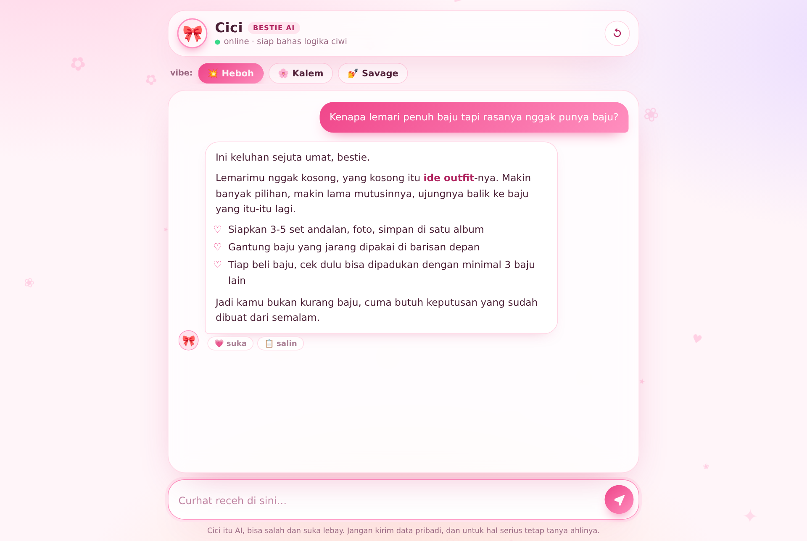

# Tanya Cici

A small Indonesian small-talk chatbot: a web UI plus a thin backend that talks to the
Google Gemini API. It answers everyday, lighthearted questions in the voice of a friend,
and keeps the persona in versioned prompt files instead of in code.

The project is deliberately dependency free at runtime: Node's standard library only,
no framework, no bundler, no build step.



```
public/  browser app (ES modules, no framework)
prompts/ persona prompt, versioned as Markdown
src/     configuration, domain rules, providers, HTTP layer
api/     Vercel serverless entry point (same code paths as the local server)
test/    unit and integration tests, run with node --test
```

## Requirements

- Node.js 20.11 or newer (`.nvmrc` pins 22 for development)
- A Gemini API key for real answers: <https://aistudio.google.com/apikey>

## Quick start

Run the UI first with canned answers, no key and no network calls:

```bash
cp .env.example .env
echo "PROVIDER=mock" >> .env
npm start
# open http://localhost:3000
```

Then switch to real answers:

```bash
# in .env
PROVIDER=gemini
GEMINI_API_KEY=your-key-here
```

```bash
npm run dev     # restarts on file changes
npm test        # unit + integration tests
npm run verify  # lint, tests and secret scan, same as CI
```

## Configuration

All configuration comes from the environment and is validated at startup; the process
refuses to boot with an incomplete or out-of-range configuration. See `.env.example` for
the full list with comments.

| Variable | Default | Purpose |
| --- | --- | --- |
| `PROVIDER` | `gemini` | `gemini` for real answers, `mock` for offline work |
| `GEMINI_API_KEY` | — | Required when `PROVIDER=gemini` |
| `GEMINI_MODEL` / `GEMINI_FALLBACK_MODEL` | `gemini-3.6-flash` / `gemini-3.5-flash-lite` | Primary model and the one used when the primary is rate limited |
| `GEMINI_MAX_RETRIES` / `GEMINI_DEADLINE_MS` | `2` / `60000` | Retries per model on transient upstream failures, and the budget for the whole request |
| `HOST` / `PORT` | `127.0.0.1` / `3000` | Listen address; loopback by default |
| `TRUST_PROXY` | `false` | Whether `X-Forwarded-For` may be trusted for rate limiting |
| `ALLOWED_ORIGINS` | empty | Extra browser origins allowed to call the API; empty means same origin only |
| `RATE_LIMIT_PER_MIN` | `12` | Requests per client per minute |
| `MAX_MESSAGE_CHARS` / `MAX_HISTORY_MESSAGES` | `1000` / `16` | Size of the conversation window sent to the model |
| `LOG_LEVEL` | `info` | `debug`, `info`, `warn`, `error`, `silent` |

## How a request flows

```
browser ──POST /api/chat──▶ chat route ──▶ chat service ──▶ provider ──▶ Gemini API
             │                  │               │
             │                  │               └── persona prompt (prompts/*.md)
             │                  └── rate limit, origin check, body limit
             └── validation errors and quota messages come back as {error:{code,message}}
```

Details and the reasoning behind the layering are in [docs/ARCHITECTURE.md](docs/ARCHITECTURE.md).

## Deployment (Vercel)

1. Push the repository to GitHub. `.env` is ignored by git; if you upload through the web
   interface instead, move the file out of the folder first, because `.gitignore` does not
   apply to drag and drop uploads.
2. Import the project in Vercel and add `GEMINI_API_KEY` as an environment variable.
3. Deploy. `vercel.json` serves `public/` as static output, ships `prompts/` with the
   function, and sets the same security headers as the local server.

## Known trade-offs

These are deliberate choices for a personal-scale project, not oversights:

- **Rate limiting is per process and in memory.** It protects the free-tier quota on a
  single instance. A multi-instance deployment needs a shared store.
- **No user accounts.** The app holds no user data server side, so there is nothing to
  authenticate or authorize. The "girls only" dialog is a joke in the UI, not an access
  control; the server treats its flag as an untrusted hint that only changes tone.
- **Conversation history lives in the browser** (`localStorage`), never on the server.
- **Free-tier prompts are used by Google to improve their products** and may be read by
  human reviewers. The UI says so and the app is not meant for sensitive data. See
  [docs/SECURITY.md](docs/SECURITY.md).
- **Model answers are not verified.** The persona forbids inventing statistics, but an LLM
  can still be wrong; the UI states this.

## License

MIT, see [LICENSE](LICENSE).
